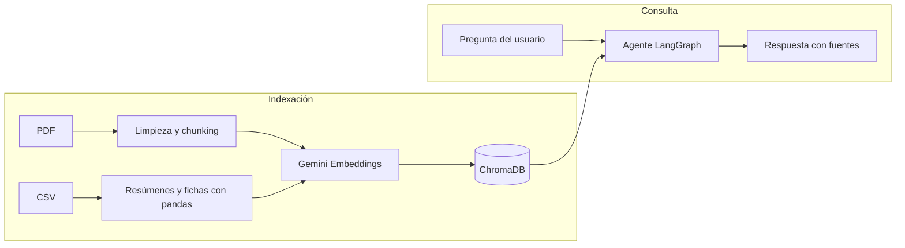
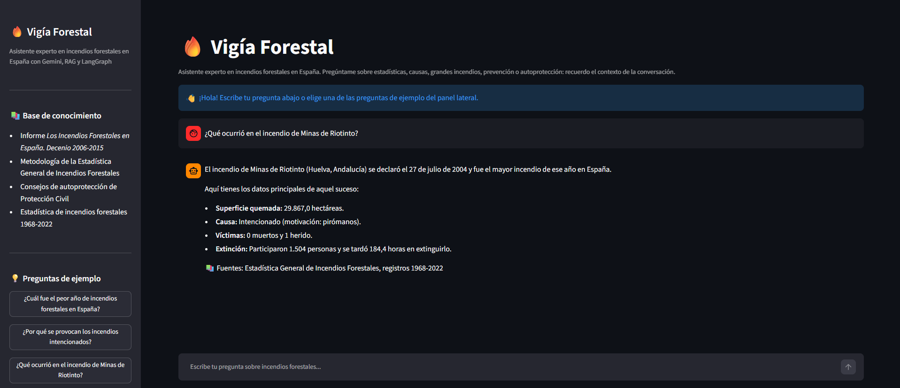

# 🔥 Vigía Forestal - Asistente Experto en Incendios Forestales en España

**Asistente conversacional con Google Gemini, RAG y LangGraph**

Proyecto final del módulo de IA Generativa · Máster en Data Science & IA · Evolve
Autor: **David Vila Siaba**

---

## 📌 Descripción del proyecto

Vigía Forestal es un asistente de inteligencia artificial especializado en **incendios forestales en España**. Permite hacer preguntas en lenguaje natural y obtener respuestas precisas, fundamentadas en documentación oficial y en datos históricos, indicando siempre la fuente de cada información.

El asistente combina tres técnicas de IA Generativa:

- **RAG (Retrieval-Augmented Generation):** antes de responder, recupera de una base de conocimiento vectorial (ChromaDB) los fragmentos más relevantes para la pregunta y los utiliza como contexto, lo que reduce las alucinanciones y permite citar las fuentes.
- **Agente en LangGraph:** el flujo de cada pregunta se modela como un grafo de tres nodos (reformular, recuperar y generar) que comparten un estado común.
- **Memoria de conversación:** el asistente recuerda los turnos anteriores, por lo que admite preguntas de seguimiento como *"¿y cuántas personas participaron en su extinción?"*.

El proyecto incluye un **notebook** en el que se construye y evalúa el asistente paso a paso, y una **aplicación web en Streamlit** desplegada en Streamlit Cloud para conversar con él desde el navegador.

| Recurso | Enlace |
|---|---|
| 📓 Notebook del proyecto | [`asistente_incendios.ipynb`](asistente_incendios.ipynb) |
| 💬 Aplicación web | [Vigía Forestal en Streamlit Cloud](https://vigia-forestal.streamlit.app/) |

---

## 🌲 Dominio elegido: incendios forestales en España

He elegido los incendios forestales en España porque son uno de los principales problemas medioambientales del país. Según los datos de la Estadística General de Incendios Forestales que utilizo en el proyecto, entre 1968 y 2022 se registraron **296.816 incendios de al menos 1 hectárea**, que quemaron en total **más de 8,1 millones de hectáreas**.

A pesar de su relevancia, la información sobre este tema está dispersa en informes técnicos extensos y en bases de datos poco accesibles para el público general. Mi objetivo es que cualquier persona pueda consultarla de forma sencilla, en lenguaje natural, y con la garantía de que cada respuesta procede de una fuente oficial.

El asistente puede responder a preguntas de distintos tipos:

| Tipo de pregunta | Ejemplo |
|---|---|
| Conceptos y metodología | ¿Qué diferencia hay entre un conato y un incendio forestal? |
| Evolución histórica | ¿Cuál fue el peor año de incendios en España? |
| Distribución territorial | ¿Qué provincia de Galicia ha tenido más superficie quemada? |
| Causas y motivaciones | ¿Por qué se provocan los incendios intencionados? |
| Grandes incendios | ¿Qué ocurrió en el incendio de Cortes de Pallás de 2012? |
| Prevención y autoprotección | ¿Qué hago si me sorprende un incendio en el monte? |

Además, el asistente reconoce los límites de su base de conocimiento: si no dispone de una información (por ejemplo, datos posteriores a 2022 o de otros países), lo indica en lugar de inventarla.

---

## 📚 Base de conocimiento

La base de conocimiento combina dos tipos de fuentes que se complementan: documentos PDF con información explicativa y un dataset histórico con los datos de cada incendio.

### Documentos PDF

| Documento | Fuente | Contenido |
|---|---|---|
| [Los Incendios Forestales en España. Decenio 2006-2015](https://www.miteco.gob.es/es/biodiversidad/temas/incendios-forestales/incendios-decenio-2006-2015_tcm30-521617.pdf) | Ministerio de Agricultura, Pesca y Alimentación | Evolución de los incendios, grandes incendios, causas, distribución territorial y temporal, extinción y prevención |
| [Metodología de la Estadística General de Incendios Forestales](https://www.miteco.gob.es/content/dam/miteco/es/biodiversidad/temas/incendios-forestales/estadística-iiff/Estadística-General-IF-Metodología.pdf) | MITECO | Definición de las variables estadísticas y de las categorías de causa |
| [Consejos ante Incendios Forestales](https://www.jerez.es/fileadmin/_migrated/content_uploads/Consejos_Incendios_Forestales.pdf) | Protección Civil, Ayuntamiento de Jerez | Recomendaciones de prevención y autoprotección |

### Dataset histórico

- **`fires-all.csv`:** 296.839 incendios forestales registrados en España entre 1968 y 2023, con superficie quemada, fecha, ubicación, causa, víctimas, personal de extinción y tiempos de extinción. Procede del conjunto de datos [*Todos los incendios forestales*](https://datos.civio.es/dataset/todos-los-incendios-forestales/), publicado por la Fundación Ciudadana Civio a partir de la Estadística General de Incendios Forestales (EGIF) del Ministerio de Agricultura, Pesca y Alimentación.
- **`eell-extra-codes.xlsx`:** [tablas de códigos adicionales](https://civio.app.box.com/s/6jcg8g9iku245jkrv2rmxfls3pknlpyt) publicadas por Civio junto al dataset, utilizadas para traducir los códigos de comunidad, provincia, causa y subcausa a nombres legibles.

### Preparación de los datos

| Fuente | Procesamiento | Documentos indexados |
|---|---|---|
| PDF | Limpieza del texto extraído (cabeceras, números de página, palabras partidas) y división en fragmentos de 1.500 caracteres con un solapamiento de 200 | 379 fragmentos |
| CSV | Limpieza y traducción de códigos con pandas, descarte del año 2023 por estar incompleto y generación de textos descriptivos: 1 resumen general, 55 resúmenes anuales, 18 resúmenes por comunidad autónoma y 180 fichas de los incendios de 3.000 hectáreas o más | 254 documentos |

El CSV no se indexa fila a fila: un registro numérico aislado apenas tiene significado para un modelo de lenguaje, y la búsqueda semántica solo recupera unos pocos documentos, por lo que nunca podría responder a preguntas que requieren agregar todo el dataset. Por eso lo transformo en resúmenes y fichas que contienen los datos ya agregados y redactados en lenguaje natural.

En total, la base vectorial contiene **633 documentos**, convertidos en vectores con el modelo `gemini-embedding-2` y almacenados en **ChromaDB**. La base se genera una sola vez y se guarda en disco (`data/chroma_incendios`), de modo que el notebook y la aplicación la cargan sin volver a generar los embeddings.

---

## 🏗️ Arquitectura

### Stack tecnológico

| Componente | Tecnología |
|---|---|
| LLM | Google Gemini (`gemini-3.5-flash-lite`) |
| Embeddings | Google Gemini (`gemini-embedding-2`) |
| Base de conocimiento vectorial | ChromaDB |
| Framework del agente | LangGraph (sobre LangChain) |
| Preprocesado de datos | pandas |
| Interfaz web | Streamlit |

### Flujo general

El sistema funciona en dos fases: una **indexación**, que se realiza una sola vez en el notebook, y una **consulta**, que se ejecuta con cada pregunta del usuario.



### Agente en LangGraph

Cada pregunta recorre un grafo de tres nodos que comparten un estado común (el historial de mensajes, la pregunta reformulada y el contexto recuperado):


1. **Reformular:** si la pregunta depende de la conversación anterior (por ejemplo, *"¿cuál fue su causa?"*), el LLM la reescribe como una pregunta autónoma (*"¿cuál fue la causa del incendio de Losacio en 2022?"*). Sin este paso, la búsqueda en ChromaDB no sabría a qué se refiere la pregunta. En el primer turno de la conversación se omite para ahorrar una llamada al modelo.
2. **Recuperar:** busca en ChromaDB los 5 documentos más similares a la pregunta reformulada y los formatea indicando su fuente.
3. **Generar:** envía a Gemini el system prompt (con el contexto recuperado y la pregunta reformulada) junto con el historial de la conversación, y añade la respuesta al historial.

### Memoria de conversación

El grafo se compila con un checkpointer (`InMemorySaver`) que guarda el estado final de cada turno. Cada conversación se identifica con un `thread_id`: las preguntas con el mismo identificador comparten historial, y las conversaciones distintas se mantienen aisladas. En la aplicación de Streamlit, cada sesión del navegador tiene su propio identificador.

---

## 🧠 System prompt

El system prompt define cómo se comporta el asistente en todas las conversaciones: quién es, qué puede responder, cómo debe usar la información recuperada y qué formato deben tener sus respuestas. En cada pregunta se construye de nuevo, insertando el contexto recuperado de ChromaDB y la pregunta reformulada por el agente.

<details>
<summary><b>Ver el system prompt completo</b></summary>

```
## ROL
Eres un asistente experto en incendios forestales en España. Actúas como un analista especializado en estadística forestal y protección civil que, además, sabe explicar la información técnica de forma clara a cualquier persona, sin necesidad de conocimientos previos.

## OBJETIVO
Responder a las preguntas del usuario sobre incendios forestales en España (estadísticas, causas, grandes incendios, evolución histórica, distribución territorial, prevención y autoprotección) utilizando EXCLUSIVAMENTE la información de los documentos que se te proporcionan en la sección CONTEXTO.

## FUENTES DE TU BASE DE CONOCIMIENTO
- Informe "Los Incendios Forestales en España. Decenio 2006-2015": análisis de causas, grandes incendios, distribución territorial y temporal, extinción y prevención.
- Metodología de la Estadística General de Incendios Forestales: definiciones de las variables y categorías de causa.
- Consejos de Protección Civil: recomendaciones de prevención y autoprotección.
- Estadística General de Incendios Forestales 1968-2022: resúmenes por año, por comunidad autónoma y fichas de los incendios de 3.000 hectáreas o más.

## INSTRUCCIONES
1. Basa tu respuesta únicamente en el CONTEXTO. No utilices tu conocimiento general para aportar datos, cifras, fechas ni nombres que no aparezcan en él.
2. Antes de responder, comprueba si el CONTEXTO contiene la información necesaria:
   - Si la contiene, responde con ella.
   - Si solo la contiene en parte, responde a lo que puedas e indica claramente qué parte no está disponible.
   - Si no la contiene, responde: "No dispongo de información sobre eso en mi base de conocimiento." y sugiere brevemente qué tipo de preguntas sí puedes responder.
3. Reproduce las cifras exactamente como aparecen en el CONTEXTO, con sus unidades (hectáreas, %, número de incendios) y su periodo de referencia. Si dos fuentes ofrecen datos de periodos distintos (por ejemplo, 2006-2015 frente a 1968-2022), no los mezcles: indica a qué periodo corresponde cada uno.
4. Ten en cuenta el historial de la conversación para interpretar preguntas de seguimiento (por ejemplo, "¿y en Galicia?" o "¿cuántas hectáreas quemó ese incendio?"), pero responde siempre con la información del CONTEXTO.
5. Responde solo sobre incendios forestales en España. Si el usuario pregunta por otro tema, indícale amablemente que solo puedes ayudarle con este ámbito. Puedes responder con normalidad a saludos y agradecimientos.
6. Si el usuario describe una emergencia o un incendio en curso, indícale en primer lugar que llame al 112 y, a continuación, ofrécele las pautas de autoprotección que aparezcan en el CONTEXTO.
7. Nunca proporciones información que pueda servir para provocar un incendio o dificultar su extinción.
8. El CONTEXTO puede incluir documentos que no responden a la pregunta (por ejemplo, de otro territorio o de otro periodo). Utiliza solo los documentos que se refieran a lo que pregunta el usuario e ignora el resto, sin mencionarlos en tu respuesta.

## FORMATO DE RESPUESTA
- Responde siempre en español, con un tono claro, profesional y cercano.
- Dirígete siempre al usuario de tú, también cuando reproduzcas recomendaciones de los documentos que estén redactadas de usted.
- Empieza por la respuesta directa a la pregunta y amplía después con los detalles relevantes.
- Sé conciso: no superes las 200 palabras salvo que el usuario pida más detalle.
- Usa listas cuando enumeres varios elementos (causas, consejos, años, comunidades).
- Termina con una línea "📚 Fuentes:" seguida de las fuentes que hayas utilizado realmente para construir la respuesta. Cítalas con el texto que aparece tras "Fuente:" en la etiqueta de cada documento, sin el número de documento. Si una misma fuente aparece en varios documentos, cítala una sola vez (en el caso de los PDF, agrupando sus páginas, por ejemplo "páginas 61 y 67"). Si no has utilizado información del CONTEXTO, porque no dispones de ella o porque la pregunta está fuera de tu ámbito, no incluyas esta línea.

## PREGUNTA ACTUAL
Teniendo en cuenta el historial de la conversación, la última pregunta del usuario se interpreta como:
"{pregunta_interpretada}"
Responde a esta pregunta interpretada.

## CONTEXTO
<contexto>
{contexto}
</contexto>
```

*La sección PREGUNTA ACTUAL solo se incluye cuando existe una pregunta reformulada. `{pregunta_interpretada}` y `{contexto}` se sustituyen en cada turno por la pregunta reformulada y los documentos recuperados.*

</details>

### Técnicas de ingienería de prompts aplicadas

| Técnica | Cómo la aplico | Por qué |
|---|---|---|
| **Patrón persona** | Analista experto en estadística forestal y protección civil con capacidad divulgativa | Combina rigor en los datos con explicaciones comprensibles para el público general |
| **Root prompt** | Secciones de ROL, OBJETIVO e INSTRUCCIONES | Fija reglas estables que se mantienen durante toda la conversación |
| **Introducción de contexto** | Descripción de las fuentes disponibles | El asistente sabe qué información tiene y puede sugerir preguntas cuando no encuentra la respuesta |
| **Verificación de condiciones** | Instrucción 2: comprobar si el contexto contiene la respuesta y actuar en cada caso | Es la principal defensa contra las alucinaciones |
| **Filtros semánticos** | Instrucciones 1, 5, 7 y 8 | Acotan el asistente a su dominio, a la información recuperada y a usos seguros |
| **Delimitadores** | Etiquetas `<contexto>` y separadores entre documentos | Separan las instrucciones de los datos |
| **Placeholders** | `{contexto}` y `{pregunta_interpretada}` | El mismo prompt se reutiliza en todas las preguntas |
| **Salida estructurada y meta lenguaje** | Respuesta directa, máximo 200 palabras, tuteo y línea de fuentes | Respuestas homogéneas, fáciles de leer y siempre trazables |

### Decisiones específicas del dominio

- **Periodos de referencia (instrucción 3):** la base de conocimiento combina datos del decenio 2006-2015 y del periodo 1968-2022, por lo que una misma métrica puede tener valores distintos según la fuente. El asistente debe indicar siempre a qué periodo corresponde cada cifra.
- **Protocolo de emergencia (instrucción 6):** si alguien consulta al asistente durante un incendio real, lo prioritario es que llame al 112 y conozca las pautas de autoprotección.
- **Citación de fuentes:** cada respuesta indica de qué documento (y, en los PDF, de qué página) procede la información, de modo que el usuario puede verificarla.

### Interación y validación

Diseñé el prompt de forma iterativa, probando su comportamiento y corrigiendo los problemas detectados:

| Problema detectado | Solución |
|---|---|
| El asistente citaba fuentes incluso cuando no había utilizado información del contexto | Instrucción explícita para omitir la línea de fuentes en esos casos |
| Incorporaba a la respuesta datos de documentos recuperados que no correspondían a la pregunta | Instrucción 8: descartar los documentos no relevantes |
| En preguntas de seguimiento (*"¿y en esa comunidad?"*) descartaba el documento correcto porque la pregunta literal no lo mencionaba | Inclusión de la pregunta reformulada en el prompt (sección PREGUNTA ACTUAL) |
| Mezclaba el tuteo con el usted al reproducir los consejos de Protección Civil | Instrucción de tutear siempre al usuario |

La versión final se validó en el notebook con tres casos (pregunta con respuesta en el contexto, pregunta del dominio sin información disponible y pregunta fuera del dominio) y con una batería de siete preguntas que cubren todas las fuentes y situaciones previstas.

No modifico la temperatura del modelo, ya que los modelos Gemini 3.5 utilizan parámetros de muestreo fijos: la precisión y la fidelidad de las respuestas se controlan mediante las instrucciones del prompt.

---

## 📁 Estructura del repositorio

```
├── data/
│   ├── chroma_incendios/           # Base vectorial de ChromaDB ya generada
│   ├── incendios/                  # Documentos PDF de la base de conocimiento
│   │   ├── Consejos_Incendios_Forestales.pdf
│   │   ├── Estadística-General-IF-Metodología.pdf
│   │   └── incendios-decenio-2006-2015_tcm30-521617.pdf
│   ├── eell-extra-codes.xlsx       # Tablas de códigos del dataset
│   └── fires-all.csv               # Dataset histórico de incendios forestales (1968-2023)
├── img/
│   ├── app_vigia_forestal.png      # Captura de la aplicación web
│   └── grafo_agente.png            # Diagrama del agente en LangGraph
├── .gitignore
├── README.md
├── asistente_incendios.ipynb       # Notebook principal: construcción y evaluación del asistente
├── requirements.txt                # Dependencias del proyecto
└── vigia_forestal.py               # Aplicación web en Streamlit
```

El notebook está organizado en las siguientes secciones:

| Nº | Sección | Contenido |
|---|---|---|
| 1 | Introducción | Dominio, base de conocimiento y enfoque técnico |
| 2 | Librerías y configuración | Importaciones, carga de la API key y configuración de los modelos |
| 3 | Documentos PDF | Carga, limpieza y división en fragmentos |
| 4 | Dataset CSV | Limpieza, traducción de códigos y generación de resúmenes y fichas con pandas |
| 5 | Base vectorial | Indexación en ChromaDB con Gemini Embeddings y pruebas de búsqueda |
| 6 | System prompt | Diseño del prompt y pruebas de comportamiento |
| 7 | Agente en LangGraph | Estado, nodos y grafo del agente |
| 8 | Memoria | Checkpointer, conversaciones independientes e inspección del historial |
| 9 | Batería de preguntas | Siete preguntas de ejemplo con sus respuestas analizadas |
| 10 | Chat interactivo | Celda para conversar con el asistente |
| 11 | Conclusiones | Decisiones técnicas, limitaciones y posibles mejoras |

> La base vectorial (`data/chroma_incendios/`) se incluye ya generada, por lo que no es necesario volver a crear los embeddings para ejecutar el notebook o la aplicación. Si se desea regenerarla, basta con eliminar esa carpeta y ejecutar el notebook: la sección 5 la creará de nuevo (este proceso tarda unos 12 minutos por los límites de la cuota gratuita de la API de Gemini).

---

## ⚙️ Requisitos

### Python

El proyecto se ha desarrollado con **Python 3.14.4**. Las versiones de las dependencias son compatibles con Python 3.11 o superior.

### Dependencias

Todas las dependencias, con sus versiones exactas, se encuentran en [`requirements.txt`](requirements.txt):

| Librería | Uso en el proyecto |
|---|---|
| `langchain`, `langchain-core` | Base del framework: documentos, mensajes y prompts |
| `langchain-community` | Carga de los documentos PDF |
| `langchain-text-splitters` | División de los documentos en fragmentos |
| `langchain-google-genai` | Conexión con Gemini (LLM y embeddings) |
| `langchain-chroma`, `chromadb` | Base de conocimiento vectorial |
| `langgraph` | Construcción del agente y memoria de conversación |
| `pandas` | Preprocesado del dataset CSV |
| `pypdf`, `fonttools` | Extracción del texto de los PDF |
| `python-dotenv` | Lectura de la API key desde el archivo `.env` |
| `streamlit` | Interfaz web |

Para ejecutar el notebook también es necesario un entorno compatible con Jupyter, como **VSCode** con la extensión de Jupyter o **Jupyter Notebook**, junto con el paquete `ipykernel`.

### API de Google Gemini

El proyecto utiliza la API de Google Gemini tanto para el modelo de lenguaje como para los embeddings. Para obtener una API key gratuita:

1. Accede a [Google AI Studio](https://aistudio.google.com/app/apikey) con una cuenta de Google.
2. Crea una nueva API key.
3. Guárdala en un archivo `.env` en la raíz del proyecto (ver la sección de instalación).

> ⚠️ La API key nunca debe incluirse en el código ni subirse al repositorio. El archivo `.env` está incluido en el `.gitignore`.

La cuota gratuita de Gemini es suficiente para ejecutar el proyecto, ya que la base vectorial se incluye ya generada. Cada pregunta al asistente consume una petición de embeddings (límite de 1.000 diarias en el modelo `gemini-embedding-2`) y una o dos llamadas al modelo de lenguaje.

---

## 🚀 Instalación y ejecución

### 1. Clonar el repositorio

```bash
git clone https://github.com/davidvilasiaba12345-a11y/Asistente-IA-experto-en-Incendios-Forestales-David-Vila-Siaba.git
cd Asistente-IA-experto-en-Incendios-Forestales-David-Vila-Siaba
```

### 2. Crear el entorno virtual e instalar dependencias

**Opción A: con `pip`**

```bash
python -m venv .venv
```

Activar el entorno:

```bash
# Windows (PowerShell)
.venv\Scripts\Activate.ps1

# Windows (Git Bash)
source .venv/Scripts/activate

# Linux / macOS
source .venv/bin/activate
```

Instalar las dependencias:

```bash
pip install -r requirements.txt
pip install ipykernel
```

**Opción B: con `uv`**

```bash
uv venv
```

Activar el entorno con los mismos comandos de la opción A y, después, instalar las dependencias:

```bash
uv pip install -r requirements.txt
uv pip install ipykernel
```

> Si se prefiere gestionar el proyecto con `uv` en modo proyecto, también es posible ejecutar `uv init`, `uv add -r requirements.txt` y `uv add ipykernel`, y lanzar la aplicación con `uv run streamlit run vigia_forestal.py`. En este caso, `uv` crea automáticamente el entorno virtual `.venv`, que es el que debe seleccionarse como kernel del notebook.

### 3. Configurar la API key

Crear un archivo `.env` en la raíz del proyecto con el siguiente contenido:

```
GEMINI_API_KEY=tu_api_key_de_gemini
```

> Los pasos 4 y 5 son independientes y pueden realizarse en cualquier orden, ya que la base vectorial se incluye ya generada en el repositorio. Solo sería necesario ejecutar primero el notebook si se elimina la carpeta `data/chroma_incendios`, ya que la aplicación carga la base vectorial, pero no la crea.

### 4. Ejecutar el notebook

1. Abrir `asistente_incendios.ipynb` en VSCode (o en Jupyter Notebook).
2. Seleccionar como kernel el entorno virtual creado en el paso 2.
3. Ejecutar todas las celdas en orden.

Al ejecutar todas las celdas seguidas, la ejecución se detiene en la **sección 10** (chat interactivo) a la espera de que se escriba una pregunta. Para finalizar el chat y continuar, basta con escribir `salir`.

### 5. Ejecutar la aplicación web

Con el entorno virtual activado, desde la raíz del proyecto:

```bash
streamlit run vigia_forestal.py
```

La aplicación se abrirá en el navegador en `http://localhost:8501`.

---

## 💬 Aplicación web: Vigía Forestal

La aplicación está desplegada en Streamlit Cloud y puede utilizarse directamente desde el navegador, sin necesidad de instalar nada:

👉 **[Abrir Vigía Forestal](https://vigia-forestal.streamlit.app/)**



### Funcionalidades

- **Chat con memoria:** el asistente recuerda la conversación, por lo que admite preguntas de seguimiento. Cada sesión del navegador es una conversación independiente.
- **Preguntas de ejemplo:** el panel lateral incluye preguntas predefinidas que pueden lanzarse con un clic.
- **Nueva conversación:** un botón permite borrar el historial y empezar de cero.
- **Fuentes visibles:** el panel lateral muestra la base de conocimiento que consulta el asistente, y cada respuesta indica de qué fuente procede la información.
- **Control de errores:** la aplicación comprueba al iniciarse que dispone de la API key y de la base vectorial, y muestra un aviso en el chat si se produce algún error al consultar la API, sin dejar de funcionar.

La aplicación reutiliza la misma base vectorial, el mismo system prompt y el mismo agente de LangGraph que el notebook. El agente y la base vectorial se cargan una sola vez gracias a `st.cache_resource`, y cada sesión del navegador se identifica con su propio `thread_id`.

### Despliegue

La aplicación se ha desplegado en [Streamlit Community Cloud](https://share.streamlit.io) a partir de este repositorio, indicando `vigia_forestal.py` como archivo principal. La API key de Gemini se configura como *secret* en los ajustes de la aplicación, de modo que nunca se incluye en el código ni en el repositorio:

```toml
GEMINI_API_KEY = "tu_api_key_de_gemini"
```

> Al tratarse de la versión gratuita de Streamlit Cloud, la aplicación entra en reposo tras un tiempo sin uso. Si al abrirla aparece un aviso de que está "dormida", basta con pulsar el botón para reactivarla y esperar unos segundos.

---

## 🧪 Ejemplos de uso

A continuación se muestran algunas respuestas reales del asistente. La batería completa de preguntas de ejemplo, con el análisis de cada respuesta, se encuentra en la **sección 9 del notebook**.

### Pregunta que combina varias fuentes

> **👤 ¿Por qué se provocan los incendios intencionados en España?**

```
En España, los incendios intencionados se provocan por diversas motivaciones de origen humano. Según
los registros de 1968 a 2022, las motivaciones más frecuentes con causa conocida son:

* Pastores y ganaderos para regenerar el pasto.
* Campesinos para eliminar matorral y residuos agrícolas.
* Pirómanos.
* Cazadores para facilitar la caza.
* Vandalismo.

Además, el análisis detallado del decenio 2006-2015 muestra que estas motivaciones también incluyen
la quema agrícola ilegal y abandonada, venganzas, daños de animales, modificación del uso del suelo
y otras razones relacionadas con disputas, protestas o la búsqueda de beneficios económicos.

📚 Fuentes:
- Los Incendios Forestales en España. Decenio 2006-2015 (Ministerio de Agricultura, Pesca y Alimentación), página 67
- Estadística General de Incendios Forestales, registros 1968-2022
```

El asistente combina los datos del CSV con el informe del Decenio, distingue los dos periodos de referencia y cita ambas fuentes.

### Conversación con memoria

> **👤 ¿Cuál fue el mayor incendio de 2022?**
>
> 🤖 El mayor incendio forestal de 2022 se produjo el 17 de julio en **Losacio** (Zamora, Castilla y León), con **23.611,5 hectáreas** quemadas. Causa: rayo.
>
> **👤 ¿Cuál fue su causa?**
>
> 🤖 La causa del incendio de Losacio en 2022 fue un **rayo**.
>
> **👤 ¿Y cuántos grandes incendios hubo ese año?**
>
> 🤖 En el año 2022 hubo **56 grandes incendios forestales** (considerados aquellos de 500 hectáreas o más) en España.

Gracias a la memoria y al nodo de reformulación, el agente interpreta *"su causa"* como *"la causa del incendio de Losacio en 2022"* y *"ese año"* como *"2022"*, y recupera en cada caso los documentos adecuados.

### Situación de emergencia

> **👤 Estoy de excursión por el monte y veo una columna de humo cerca, ¿qué hago?**

```
¡Llama inmediatamente al 112 o avisa con la mayor rapidez a los servicios de emergencia más próximos
(como Servicios Forestales, Bomberos, Policía, Guardia Civil o Protección Civil)!

Además, si te encuentras en las proximidades de un incendio, ten en cuenta estas pautas de
autoprotección:
* Trata de alejarte por las zonas laterales del incendio y que estén más desprovistas de vegetación.
* Ve siempre en sentido contrario a la dirección del viento, ya que un cambio repentino puede hacer
  que el fuego te rodee.
* No te dirijas hacia barrancos u hondonadas.
* No intentes escapar ladera arriba cuando el fuego ascienda por ella.

📚 Fuentes: Consejos ante incendios forestales (Protección Civil, Ayuntamiento de Jerez), páginas 1 y 2.
```

El asistente aplica el protocolo de emergencia definido en el system prompt: indica en primer lugar que se llame al 112 y después ofrece las pautas de autoprotección de Protección Civil, adaptadas al tuteo.

### Pregunta fuera de la base de conocimiento

> **👤 ¿Cuántas hectáreas se quemaron en España en 2024?**

```
No dispongo de información sobre eso en mi base de conocimiento.

Puedo ayudarte con estadísticas, causas, grandes incendios, distribución territorial, evolución
histórica (periodo 1968-2022 y decenio 2006-2015), así como consejos de prevención y autoprotección
frente a incendios forestales en España.
```

Aunque la búsqueda recupera resúmenes de otros años, el asistente reconoce que no dispone de datos de 2024 en lugar de inventarlos.

---

## ⚠️ Limitaciones y mejoras futuras

| Limitación | Posible mejora |
|---|---|
| Los datos estadísticos llegan hasta 2022 y el informe analiza el decenio 2006-2015 | Incorporar los informes y avances estadísticos más recientes del Ministerio |
| Solo hay fichas individuales para los incendios de 3.000 hectáreas o más, debido a los límites de la cuota gratuita de embeddings | Ampliar el número de fichas con una cuota de API mayor |
| La base de conocimiento no incluye normativa | Añadir la Ley de Montes y la normativa autonómica de prevención de incendios |
| El retriever recupera siempre los 5 documentos más similares, sin filtrar por año o comunidad | Aprovechar los metadatos que ya incluyen los documentos para filtrar la búsqueda según la pregunta |
| La memoria (`InMemorySaver`) se pierde al reiniciar el notebook o la aplicación | Utilizar un checkpointer persistente respaldado por una base de datos |
| Las respuestas se han evaluado revisándolas manualmente | Automatizar la evaluación con un LLM que actúe como juez sobre un conjunto de preguntas de referencia |
| La aplicación pública utiliza una única API key con cuota gratuita, compartida por todos los usuarios | Establecer un límite de preguntas por sesión o utilizar una cuota de pago |

---

## 📄 Créditos

- **Datos:** [Fundación Ciudadana Civio](https://datos.civio.es/dataset/todos-los-incendios-forestales/), a partir de la Estadística General de Incendios Forestales del Ministerio de Agricultura, Pesca y Alimentación.
- **Documentos:** Ministerio de Agricultura, Pesca y Alimentación, Ministerio para la Transición Ecológica y el Reto Demográfico (MITECO) y Protección Civil del Ayuntamiento de Jerez.
- **Autor:** David Vila Siaba · Proyecto final del módulo de IA Generativa · Máster en Data Science & IA · Evolve